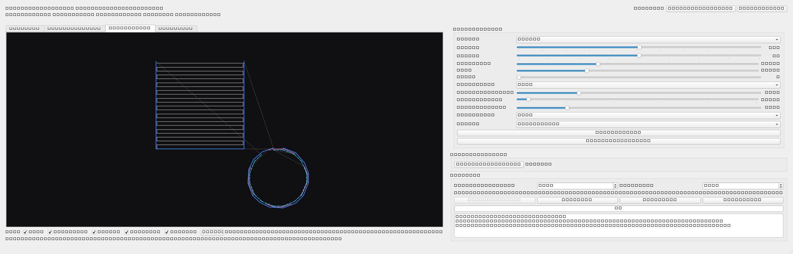

# Auto Draw Studio

Desktop em Python (PySide6) que converte imagens em desenhos e reproduz os traços
automaticamente com o mouse. Motor híbrido por região: sólidos amplos viram
**zigue-zague contínuo**, traços finos viram **linhas centrais**, furos preservados,
e áreas de tom médio podem virar **hachuras**.



## Convenção de máscara (importante)

Em todo o projeto a máscara binária é `uint8` onde
**255 = precisa de tinta (preto)** e **0 = papel (branco)**.
`thresholding.binarize` já entrega nesse formato; todos os módulos
consomem sem inverter.

## Instalação (Windows 10/11)

```powershell
python -m venv .venv
.\.venv\Scripts\Activate.ps1
pip install -r requirements.txt
```

## Execução

```powershell
python main.py
```

Fluxo: Importar imagem → ajustar limiar/brilho/contraste/gama →
conferir abas (Original / P&B / Trajetórias / Simulação) →
Selecionar área → Iniciar (F9) → contagem 5 s → desenho.
Pausar/retomar (F10, alterna), Retomar (F11), Cancelar (Esc).
O FAILSAFE do PyAutoGUI permanece ligado: arrastar o mouse ao canto
superior-esquerdo aborta.

## Calibração e preparação

1. Clique em **Selecionar área** e arraste o retângulo sobre o app de destino
   (Paint, Krita, etc.).
2. No app de destino, selecione pincel/cor/espessura antes de iniciar.
3. A proporção da imagem é preservada (`fit_aspect` + margens).
4. DPI/escala do Windows: maximize o app de destino sempre na mesma
   resolução da calibração; se mudar de monitor, calibre de novo.

## Estratégia de desenho

| Modo | O que faz |
|---|---|
| **auto** (padrão) | por região — traço fino vira linha central, sólido vira zigue-zague, furos preservados |
| **sombreado** | como o auto, mas regiões de tom **médio** viram **hachuras** (as escuras continuam chapadas) — o modo que dá cara de desenho a lápis |
| **fill** | só preenchimento por zigue-zague |
| **contour** | só contornos/detalhes (bordas limpas, sem preenchimento) |
| **centerline** | só linhas centrais (line art) |

- **Perfis:** equilibrado, rapido, fidelidade, linha_fina, logo. O rótulo do
  perfil **descreve** o estado atual: se os controles voltarem a bater com um
  preset, o nome dele reaparece; caso contrário vira "Personalizado".
- No modo **sombreado** use um **limiar alto** (≈180): as hachuras cobrem os
  tons médios, que o limiar padrão (128) não inclui.
- Hachuras: espaçamento, ângulo, tom de corte e densidade são ajustáveis
  (tons claros → hachuras mais ralas).

## Interface

- Controles com valor visível, tooltips, presets (perfis) e "Restaurar padrões".
- Abas Original / P&B / **Trajetórias** (zoom com scroll, pan com botão direito,
  filtros por tipo, deslocamentos tracejados) / Simulação.
- Etapas 1→5 no cabeçalho, botão Iniciar habilitado só quando pronto,
  cronometria de decorrido/restante pelo ritmo medido.
- Geometria da janela e divisor persistidos (QSettings).
- **Pincel (px)**: espessura do pincel do app de destino. A prévia de
  simulação passa a prever o traço real (0 = automático).
- **Resolução**: tamanho de trabalho (256…2048 px). Imagens grandes são
  reduzidas antes do processamento — increase para mais detalhe (e mais tempo).

## Projetos e exportação

- **Projeto** (`.ads.json`): guarda imagem + ajustes + trajetórias. Abrir um
  projeto restaura tudo, inclusive os atalhos.
- **SVG**: exporta as trajetórias para revisar/editar fora do app.
- **Salvar cfg**: grava só os ajustes (em `~/.auto_draw_studio/settings.json`).

## Testes

```powershell
$env:QT_QPA_PLATFORM='offscreen'; python -m pytest tests/ -q
```

206 testes (núcleo, automação com mocks, UI offscreen, baseline de qualidade).
Nenhum teste move o mouse real (backend mock). O `baseline_quality.json`
trava as métricas de qualidade por caso: se um ajuste de algoritmo piorar o
desenho (cobertura, furos, deslocamento), o teste falha.

> Os testes são **locais** (o `.gitignore` do projeto mantém `tests/` fora do
> repositório).

## Atalhos

| Ação | Padrão |
|---|---|
| Iniciar | F9 |
| Pausar / Retomar (alterna) | F10 |
| Retomar | F11 |
| Cancelar/emergência | Esc |

Configuráveis em `settings.json` (execução). Aceitam combinações com
modificadores (`ctrl+f9`) e ignoram o auto-repeat do teclado.

## Estrutura

```
app/core/        image_loader, preprocessing, thresholding, morphology,
                 contour_extractor, region_analyzer, fill_planner (zigue-zague),
                 centerline, strategy (seletor+perfis), shading_planner
                 (hachuras), path_optimizer, quality_checker, pipeline
app/automation/  screen_calibration, coordinate_mapper, mouse_executor,
                 hotkeys (pynput), execution_controller (estados + thread)
app/models/      drawing_plan (Stroke/StrokeType/DrawingPlan+SVG), settings
app/ui/          main_window, image_preview, settings_panel, widgets,
                 path_preview (zoom/pan/filtros/travel), canvas_selector,
                 process_worker (QThread), styles
app/utils/       logging_setup, persistence (JSON versionado)
tests/           suíte de UI offscreen + núcleo + baseline de qualidade
benchmarks/      bench_zigzag.py, bench_suite.py + PNGs em `benchmarks/out/`
packaging/       auto_draw_studio.spec (PyInstaller, Windows)
assets/          icon.png/ico + gerador | docs/ screenshot
```

Ordem dos traços: fills → hachuras → detalhes → internos → externos,
com vizinho-mais-próximo dentro de cada etapa (sem conectar formas
independentes).

## Limitações conhecidas

- Fotografias complexas são simplificadas (aviso de cobertura baixa);
  o programa informa em vez de fingir fidelidade. Use o modo **sombreado**
  para um resultado mais "desenhado".
- A espessura da simulação acompanha o pincel informado (ou ≈ spacing/2);
  o traço físico depende do pincel do app de destino.
- O modo centerline ignora regiões sólidas (avisa quando não acha nada).
- Seleção de área cobre o desktop virtual; multi-monitor com DPIs muito
  diferentes exige recalibração.
